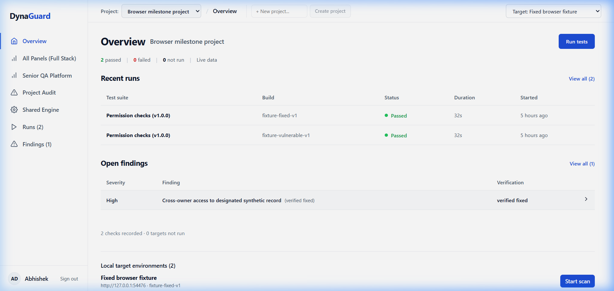
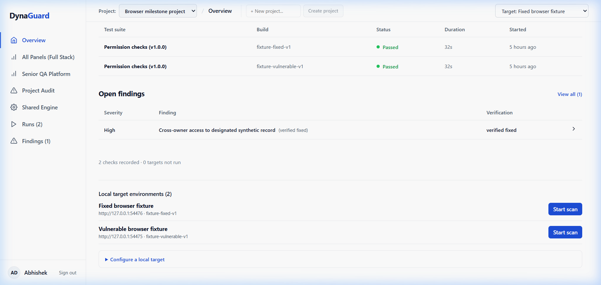
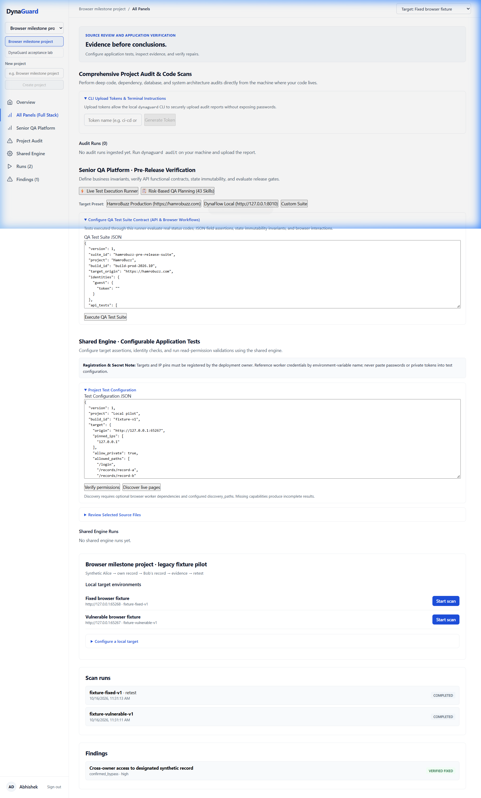
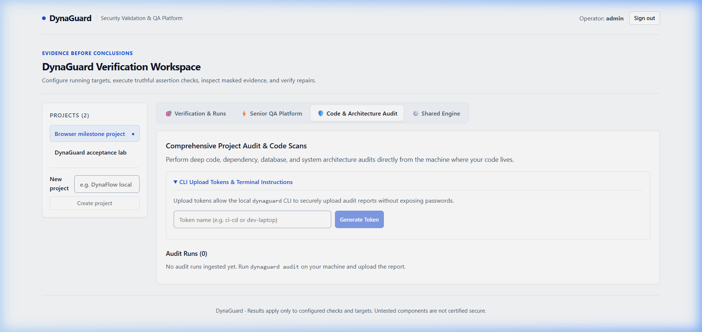
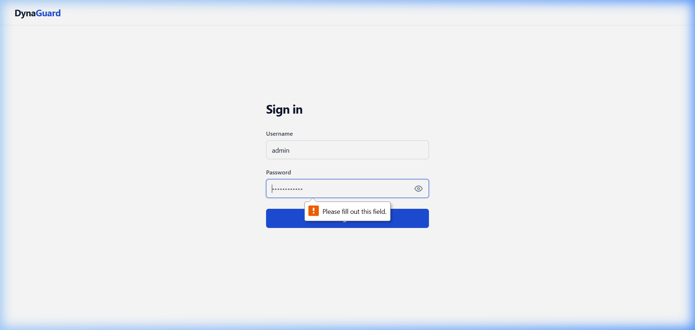
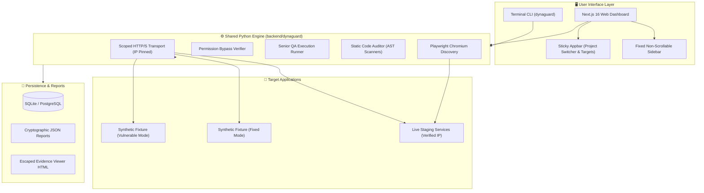

# 🛡️ DynaGuard · Security Validation & Senior QA Platform

<div align="center">

[](https://www.python.org/downloads/)
[](https://nextjs.org/)
[](https://www.typescriptlang.org/)
[](https://fastapi.tiangolo.com/)
[](https://playwright.dev/)
[](https://docs.docker.com/compose/)
[]()

**A unified security-validation engine, static code auditor, and senior QA platform featuring a terminal CLI and a modern web dashboard powered by a single core Python engine.**

[Key Features](#-key-features) • [Visual Showcase](#-visual-showcase) • [Architecture](#-architecture) • [Quick Start](#-quick-start) • [Senior QA Platform](#-senior-qa-platform) • [Security & Boundaries](#-security-principles--safe-boundaries)

---



</div>

---

## 🌟 Key Features

| Capability | CLI Support | Web Dashboard | Security & Coverage Boundaries |
|:---|:---:|:---:|:---|
| **Security Validation Engine** | ✅ `dynaguard verify` | ✅ Interactive UI | Synthetic identity tests, cross-owner authorization checks, exact record assertions |
| **Appbar Project Switcher** | N/A | ✅ Fixed Header | Instant multi-project switching and inline `+ New project` creation in top sticky bar |
| **Fixed Ergonomic Sidebar** | N/A | ✅ Non-Scrollable | Zero-scroll fixed navigation bar (`100vh`) with dedicated content container scrolling |
| **Senior QA Testing Suite** | ✅ CLI Runner | ✅ Visual Panel | Risk matrix mapping, automated contract assertions, response time tracking, regression suites |
| **Static Code Audit** | ✅ `dynaguard scan` | ✅ Visual Panel | Heuristic AST pattern matcher covering credentials, CORS, SQLi, and secret leakages |
| **Live Browser Discovery** | ✅ `dynaguard discover`| ✅ Background Worker | Headless Chromium rendering, asset inspection, client-side exposure auditing |
| **Evidence & Cryptographic Retest**| ✅ JSON/HTML | ✅ Evidence Viewer | SHA-256 test contract verification; linked historical retest without overwriting original logs |

---

## 📸 Visual Showcase

### 1. Modern Workspace & Appbar Project Switcher
The application header features a breadcrumb trail, direct project switching dropdown, inline project creation field, and environment switcher. The sidebar stays completely fixed while page content scrolls smoothly.


---

### 2. Dedicated Main-Content Scrolling
When exploring extensive test suites or audit reports, the navigation sidebar and top appbar remain securely pinned, maximizing viewport readability.



---

### 3. All-Panels Full Stack Workspace
Access the Overview, Senior QA Platform, Code Audit, Shared Engine, Runs, and Findings from a unified interface with live metric badges.



---

### 4. Code Audit & Vulnerability Inspection
Review detected heuristic patterns, severity ratings, file locations, code snippets, and remediation guidelines directly inside the audit interface.



---

### 5. Seamless Authentication Portal
Clean, accessible login experience with credential validation, role feedback, and responsive state handling.



---

## 🏗️ Architecture

DynaGuard decouples test execution logic from the user interface. Both the Command Line Interface (CLI) and the Next.js Dashboard interact with the same Python core engine (`backend/dynaguard`), ensuring test results and hash verifications are strictly identical across environments.



---

## 🚀 Quick Start

### Prerequisites
- Python **3.12+**
- Node.js **20+** & npm
- Docker & Docker Compose (optional, for full containerized deployment)

### 1. Terminal CLI Setup
Run from the repository root:

```bash
# Create and activate virtual environment
python -m venv .venv

# Linux/macOS:
source .venv/bin/activate
# Windows PowerShell:
.\.venv\Scripts\Activate.ps1

# Install backend in editable mode
python -m pip install -e ./backend
```

#### Run a Local Source Security Audit
```bash
dynaguard scan source --path /path/to/project --output source-report.json
dynaguard report --input source-report.json --output source-report.html
```

#### Execute Permission Verification Against a Running Service
```bash
# Generate sample test specification
dynaguard init --output dynaguard.json

# Execute permission verification
dynaguard verify --config dynaguard.json --output verification.json

# Render human-readable escaped HTML report
dynaguard report --input verification.json --output verification.html
```

---

### 2. Next.js Web Dashboard & API
Start both the backend API and Next.js frontend:

```bash
# Option A: One-command disposable preview server with synthetic fixtures
python scripts/smoke.py --serve
# Dashboard opens on http://127.0.0.1:3001 (User: admin, Password generated in scripts/smoke.py)

# Option B: Docker Compose Full Stack
python scripts/setup.py
docker compose up --build -d
# Dashboard opens on http://127.0.0.1:3000
```

---

## 🧪 Senior QA Platform

DynaGuard incorporates a dedicated Quality Assurance test runner designed to validate functional integrity alongside security rules:

1. **Automated Risk Matrices**:
   - Identifies business-critical risks (Identity & Authentication, Cross-tenant Data Isolation, API Latency).
   - Generates actionable mitigation strategies mapped directly to automated assertions.

2. **Multi-Step Test Contracts**:
   - Defines structured JSON test suites (`examples/qa-suite-dynaflow.json`).
   - Supports status codes, header verifications, body string matches, regex patterns, and maximum response time thresholds.

3. **Live Execution & Progress Reporting**:
   - Real-time progress bar and step-by-step console logs with duration measurements.
   - Instant filtering between passed, failed, and skipped checks.

```bash
# Run QA test suite via Python backend
python -m unittest backend/tests/test_qa_runner.py -v
```

---

## 🔒 Security Principles & Safe Boundaries

DynaGuard is built with defense-in-depth security principles to prevent scanner weaponization or server-side request forgery (SSRF):

- **Strict IP Pinning**: Target hostnames are matched against explicit DNS resolutions. Requests never follow unpinned redirects.
- **Loopback & Cloud Metadata Protection**: Private IP ranges (e.g., `169.254.169.254`, AWS/GCP instance metadata) are blocked by default unless explicitly whitelisted with `allow_private: true`.
- **Synthetic Test Records Only**: All cross-owner bypass assertions require synthetic record markers to avoid exposing sensitive real-world user data.
- **Zero Raw Credential Logging**: Reports, evidence dumps, and console output redact session tokens and passwords.
- **Explicit Test Contracts**: An HTTP `200 OK` is **never** considered a bypass without validating that designated protected payload fields were returned.

---

## 📁 Repository Layout

```text
├── backend/
│   ├── dynaguard/          # Shared engine core (CLI, transport, verifier, QA runner, audit)
│   ├── app/                # FastAPI backend service, auth, job queues, and database models
│   ├── migrations/         # Alembic database migrations
│   ├── tests/              # Engine, API, and QA runner unit/acceptance tests
│   └── fixture/            # Local synthetic application for testing vulnerable vs fixed behavior
├── dashboard/
│   ├── app/                # Next.js 16 App Router pages and tab panels
│   ├── components/ui/      # Reusable UI component library (buttons, badges, alerts, viewers)
│   ├── e2e/                # Playwright end-to-end milestone test specifications
│   └── public/             # Static dashboard assets
├── assets/                 # High-resolution UI screenshots and system diagrams
├── docs/                   # System design, verification logs, and configuration guides
├── examples/               # Example JSON verification and QA test suite templates
└── scripts/                # Automated smoke test suite, setup, and preview runners
```

---

## 🚦 Verification & Test Suite

Verify all components locally:

```bash
# 1. Backend engine unit & integration tests
cd backend
python -m unittest discover -s tests -v

# 2. Next.js Dashboard Build & TypeScript typecheck
cd ../dashboard
npm run build
npm run typecheck

# 3. Playwright E2E Milestone Test
npx playwright test
```

---

<div align="center">
  <sub>Built for precision security engineering and rock-solid quality validation.</sub>
</div>
