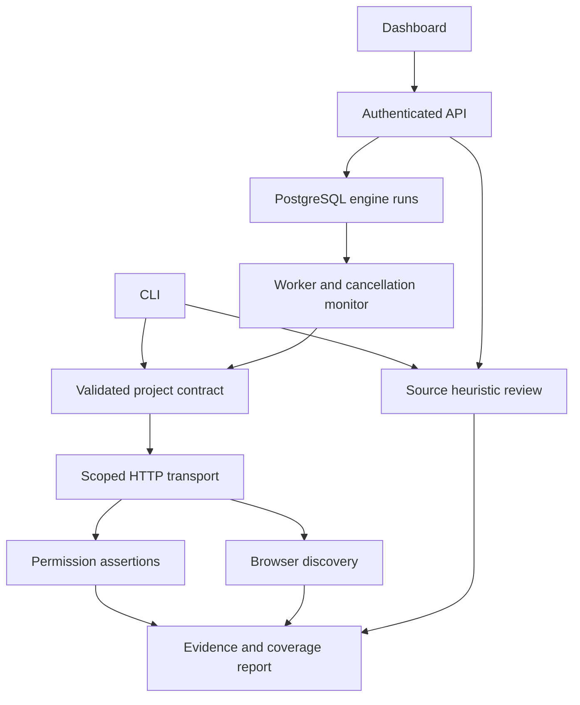

# Shared engine system logic

## Design rule

The CLI and dashboard are adapters. They call the same functions in `backend/dynaguard`; neither implements its own security decision logic. The old fixture verifier remains separate only to preserve historical behavior while migrating users.

## Modules and responsibilities

| Module | Responsibility |
|---|---|
| config.py | Strict schema, identity/test references, limits and path validation |
| network.py | Shared budget, DNS pin checks, TLS hostname verification, redirects and bounded responses |
| engine.py | Auth sessions, protected-resource assertions, outcomes and sanitized evidence |
| source.py | Seven visible heuristic rules; never executes project code |
| discovery.py | Optional browser rendering with requests mediated through network.py |
| cli.py | Local file/config adapter, exit codes, HTML export and unchanged-contract retesting |
| app/engine_api.py | Administrator-only run submission, deployment scope checks and bounded uploads |
| app/engine_worker.py | Queue claims, leases, cancellation, persistence and exception handling |
| dashboard/app/engine-panel.tsx | Configuration editor, source upload, progress and report display |

## Verification algorithm

1. Validate configuration before any network request.
2. Create one run-wide time/request budget.
3. For each test, create independent owner/probe sessions.
4. Resolve credentials from environment references at execution time.
5. Authenticate and verify each authenticated identity against its configured health assertion.
6. Request the resource as the authorized identity; require HTTP 200 and matching protected-record fields.
7. Request the same resource as the probe identity.
8. If the protected-record fields match, record a confirmed bypass, regardless of response status.
9. Otherwise require an appropriate denial, then recheck authenticated identity health.
10. Return passed only when the full expected behavior is observed. All ambiguous/failed prerequisites are incomplete.
11. Close sessions, redact known secrets, compute report hash and return multiple independent outcomes.

Credentials are not inferred from source findings or reused to explore unrelated services. Authorization expectations must come from the operator; the engine cannot infer the intended business policy reliably.

## Browser discovery

Authentication occurs through the same API session adapter. Playwright renders each explicitly configured page. All intercepted HTTP requests are fetched through ScopedHTTP; the browser never receives permission to follow arbitrary target URLs through `route.continue_`. Requests other than GET/HEAD are blocked after authentication. Service workers and WebSockets are disabled.

The worker records requested paths, resource types, response statuses and blocked reasons, not raw headers/body/query values. It lists same-origin links but does not follow them. Delivered text/JavaScript/JSON is checked by the source heuristic rules. Each match remains suspected, not a proven vulnerability.

This transport mediation does not replace VM/network isolation. A dedicated restricted browser worker remains required before treating hostile target content as trusted to execute.

## Source review

Walk text files without following symlinks; skip vendor/build folders and files larger than 1 MiB. Apply a small declared pack: private-key headers, credential assignments, disabled TLS verification, unsafe HTML rendering indicators, shell execution indicators, public database-rule patterns and database superuser declarations.

Persist rule ID, path, line and remediation guidance. Never persist matching source lines or literal secrets. Cap results at 1000; limits/read failures produce incomplete status. An empty eligible source set is incomplete. No finding means no match among scanned rules, not proof of secure code.

## Persistence and compatibility

Migration 0002 adds `engine_runs` with project, mode, immutable submitted configuration, status, lease, cancellation flag and JSON report. A versioned report contains many executions/findings. JSON storage avoids rewriting old fixture tables; queryable normalized execution/finding tables can be introduced later if reporting volume demands it.

Legacy `scan_runs`/`test_executions`/`findings`/`evidence` retain their existing schema and endpoints. They remain the one-test fixture workflow. New configurable work uses `/engine-runs`; do not mix its report semantics with old fixture results.

API routes:

- GET /engine-template
- POST /projects/{id}/engine-runs
- GET /projects/{id}/engine-runs
- POST /engine-runs/{id}/cancel
- POST /projects/{id}/source-review

Reports are included in the project run list (latest 100 runs). Download is client-side JSON. Pagination and separate artifact endpoints are future work.

## Worker state

Queued → running → completed/incomplete/cancelled. Claims use PostgreSQL row locking with SKIP LOCKED; SQLite is only a single-worker local debugging configuration. Each job has a renewable 40-second lease. A running worker reconciles expired jobs as incomplete. No retry replays target actions automatically.

Cancellation monitors a database flag every 100 ms while work runs, cancels the asyncio task and closes sessions/browser resources through finally blocks. The final database update refuses to overwrite a previously reconciled run. A cancellation request takes precedence over a just-finished report. Source uploads are synchronous and bounded; they do not expose background cancellation.

There is one trusted worker loop in this pilot. New shared-engine and legacy fixture jobs are serviced in turn; both are bounded. Strong process-per-run isolation, worker database least privilege and a separate network gateway remain future hardening.

## Retesting

CLI retests require the original report's project/origin and the same test-contract hash, including both identity configurations. The new report links to the original run ID. The build label may change; the test expectation may not silently change. This prevents claiming a repair because the test was weakened. Changes to either identity configuration require a new scan; the retest also checks both identities' health assertions.

New dashboard runs can be repeated against a changed build, but automatic linked lifecycle updates are not yet implemented there. The UI does not claim otherwise.

## Extension contract

Every future scanner adapter must declare supported inputs, dependencies, scope, impact, timeouts, evidence fields and incomplete conditions. Each verification capability requires a vulnerable fixture and a secure counterpart. Scanner alerts must remain suspected until a suitable verifier establishes impact. AI may explain evidence later, but must not override scope or assign confirmed status without verification.
